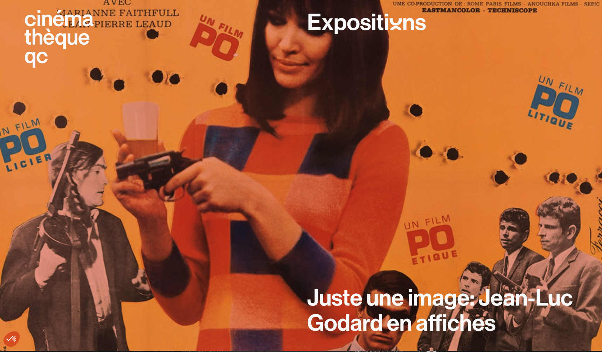
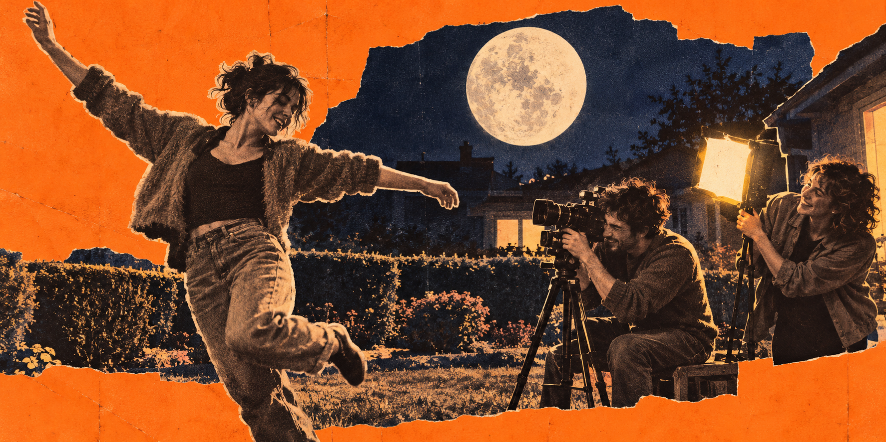
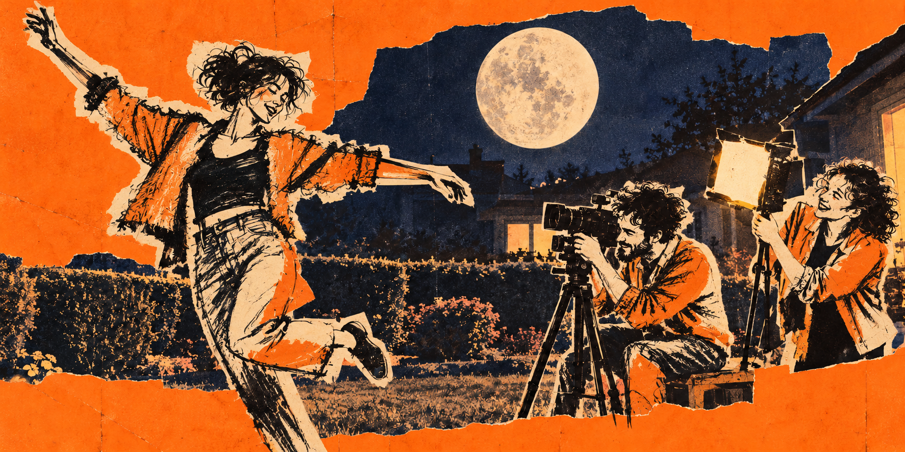
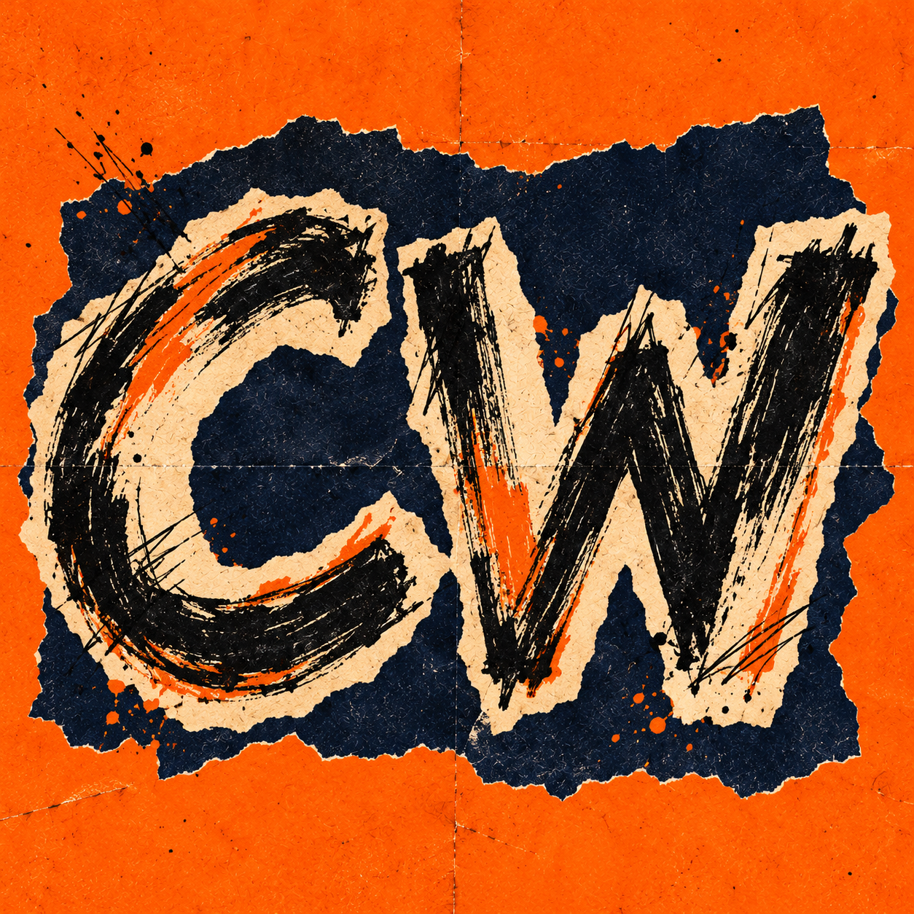
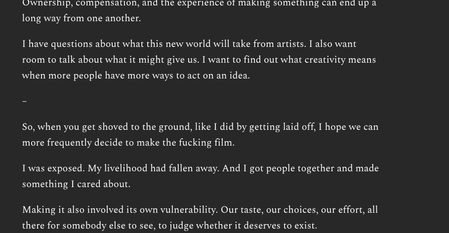
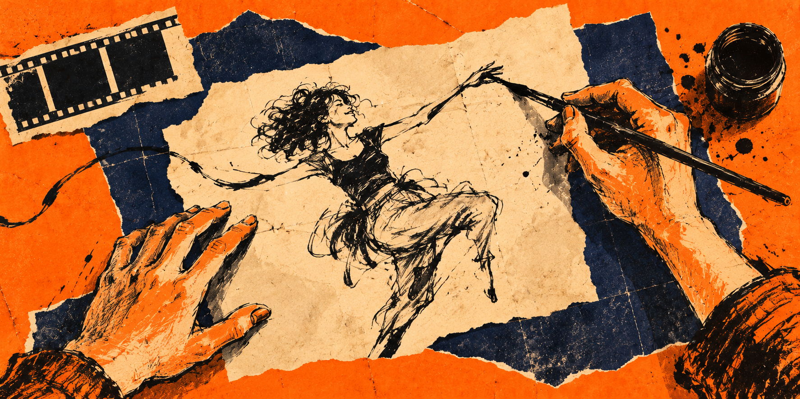

# Vulnerable: The Conversation

*Posturing while exposed · October 24, 2026 · Charles Wilke and Codex*

A working session from October 24, 2026 between Charles Wilke and Codex behind “Vulnerable: Posturing while exposed.” This transcript preserves 30 conversation turns, the original draft, two pasted revisions, the author’s note, all four generated artworks, their exact prompts, and two user-supplied reference screenshots. It ends before the request to package and publish the conversation. Internal instructions, private reasoning, routine progress updates, and raw tool output are omitted. Writing-block wrappers are removed, draft paragraph spacing is normalized, and local file links point to hosted copies. External poster images are linked rather than reproduced; the selected reference screenshot is included as supplied. Chapter headings, artwork captions, and reference descriptions are editorial additions. The discussion is preserved as it happened, including claims and suggestions later revised; it is a record of the creative process, not a separately fact-checked article.

# A Saturday morning draft

## Charles

hey there! It's saturday morning, it's been one hell of a week, and I've got thoughts:
Vulnerable
Posturing while exposed

As a person raised on the boy to man pipeline, I can tell you that vulnerability is often discussed. Generally in ways to protect yourself. Guard, shield, block. Being vulnerable growing up was synonymous with weakness. 

I’ll just give a blanket caveat to all of this. My experience for all its twists and turns, ups and downs, insides, outsides, and dimensional flips is a unique experience to me. So if I use the term we, or us, just know that I’m allowing you to include yourself, but I’m not doing it out of expectation or assumption.

Ok, let me be vulnerable here.

I don’t believe our interconnected world will remain much longer. And I don’t believe it will be an attack that causes it.

We live in the land of abundance, so caution is something we demonstrate with abundance. Especially if our monied interests land anywhere near a state of vulnerability.

The past week or so has been an incredible thing to witness. Average folk jailbroke nearly every common piece of tech. The PS5, Switch 2, iOS, Android, Alexa’s smart speaker ecosystem. It’s been remarkable watching the titans scramble to secure their walled gardens. 

Watch them race to protect this gaping vulnerability. 

But the irony of this moment is the classic corporate thought. The vulnerability is now a floating point, afforded to the increasing capabilities of these models. That means the race continues. There is no finish line. No deliverable. No Q4 push. It’s your job now. Get moving. Good luck.

So yes, I believe we’re gonna be mailing checks to our utility companies soon and forever more. I believe our relationship with our doctors will become strained. All while AI offers us better diagnostic capabilities for ourselves.

And lo, I think that’s the real vulnerability. Institutions will become less reliable, but the individual will become more capable.

And so we’re told to fear it. To avoid it, to shun it. Ever wonder why? Like, really why? The stealing art thing is bogus in the sense that the artists deserve compensation. As someone who has released art, I’ve made my compensation and sold my ownership stake. If an AI was trained on my short film *French Kitty*, then Troma gets money, not me.

So that whole argument is being propped up by spurned folk who never “made it.” And let me say, making it is an ongoing race. Just like that misconception of companies. This race against AI revealing vulnerabilities is a continuous race, there is no finish line. 

And that means artist will keep making art, because that’s how we navigate and make sense of this world. And that means AI will keep knocking on the walls, searching for a gap. And that means companies main duty will now shift to self-preservation. 

The least we can do individually is shift to self-expression.

## Codex

Hey. That closing move—from self-preservation to self-expression—is where this comes alive. You start with what growing up taught you to guard, then arrive at what you might choose to give. That gives the piece a personal reason to exist beyond its predictions about AI.

The thought I keep coming back to is: **what happens when institutions respond to their own vulnerability by asking individuals to accept less freedom?** That feels like the question underneath the walled gardens, the strained relationships, and the retreat from interconnectedness. It also connects directly to your opening: you were taught to protect yourself when exposed. You’re imagining institutions doing the same thing.

I’d give that connection more room. Right now, the leap from jailbreaks to mailing utility checks asks the reader to cross a pretty large gap. Even if every jailbreak example checks out, you still need to show why the response would be withdrawal from digital services. Your prediction gets more interesting when you explain the decisions that could produce it.

The art passage is where I’d push back. Your *French Kitty* example raises a useful question about **who actually benefits from compensation**. But describing the wider objection as something propped up by people who never made it assigns motives you haven’t established. Compensation, consent, ownership, and control are distinct questions. That passage also shifts the relationship with your reader: the opening generously lets them locate themselves in your experience; here, you start locating other people in theirs.

And I’d stay with your own vulnerability a little longer. “Let me be vulnerable” leads into a prediction, but I’m left wanting the feeling underneath it. What would losing that interconnected world mean to you? What dependence has this week made you notice? What does self-expression ask you to risk?

That’s the part only you can write. It would give the final line more weight: we’d understand what it costs you to choose it.

# Finding the French Kitty thread

## Charles

oh yeah interesting. Also I snuck a peek at your reasoning and I saw you were confused by my ask. Basically I like to play intellectual patty cake with my thoughts on saturday morning, then I publish the result to substack, it's been a nice ritual. So yeah let's talk this out. I'm interested in discussing this more. Yeah well, first I'd be super annoyed if I had to go to the bank every time I had to cash a check. But yeah I think there's a deeper pain that peeked out there about french kitty. I think my hope is that we can push forward and learn what creativity means in this new paradigm. Instead of raging at the dying of the light, maybe we can dance in this new moonlight for just a moment

## Codex

That helps—I reached for the editor’s pencil a little early. Let’s kick the thought around.

I wonder if the sting in *French Kitty* sits in the distance between **having made something and having “made it.”** You made a film. That happened; it belongs to your life. But “making it” seems to require this continuing recognition from elsewhere: another sale, another opportunity, proof that you’re still in the game. Even an accomplishment can become something you have to keep renewing.

Your example also complicates the idea of ownership. You can sell your stake in a film and still have a relationship to it that the sale barely describes. There are decisions in it that you remember making. Maybe compromises you still argue with. Other people can own the rights; you carry the experience. I wonder whether the compensation debate brushes against that gap for you.

And that makes your hope interesting to me. If we get new ways to make things, we also get an opportunity to reconsider what we want from making. Sometimes I want the finished thing. Sometimes I want to acquire the skill. Sometimes I want another person to recognize something in me. Those desires can pull in different directions. A tool that helps with one might leave another completely hungry.

The part of your moonlight line that catches me is **“for just a moment.”** There’s room in that for an experiment. You can be curious, make something, discover what the experience gives you—and still have unresolved feelings about the world taking shape around it. Admitting that curiosity can itself feel exposing when everyone seems to want a settled position.

When you think back to making *French Kitty*, where was the pleasure for you? Was there a particular part of the work you’d want more of in this new world?

## Charles

so yeah, I had written it with Chloe a year before we actually shot it. Part of the reason for the wait was the shrubs we were going to use in the background got trimmed way too far back and it looked like ass. Then a year later, I remember I got laid off, and I was like, fuck it, let's make French Kitty! And I got the gang back together, we shot it over two days, and it took like 6 months to get the paperwork figured out for Troma's release, so the thing came out nearly a year after we shot it! Basically, I loved making it, and I hated the process of getting it released

## Codex

Oh, then your closing line already has a piece of autobiography behind it. You got laid off and said, “Fuck it, let’s make *French Kitty*.” At a moment of exposure, you got your friends together and made something. That gives “shift to self-expression” a very concrete meaning.

And that changes how I hear the frustration. I’d put too much emphasis on selling the ownership stake. You’re describing a thing you loved doing, followed by a process you hated enduring to get it out into the world.

The shrubs are such a good detail here. You and Chloe had imagined something specific enough that the condition of the background mattered. Then you finally got those two days with the gang. There’s a whole account of creativity in that: wanting something to exist, caring about its particulars, getting people together to make it happen.

So maybe part of your hope for this new paradigm is getting to spend more of your life in that experience. More chances to act on “fuck it, let’s make it,” with enough energy left afterward to do it again.

But I’m curious about the release, because you stuck with it through six months of paperwork. What did a Troma release mean to you when you first pursued it—reaching an audience, being recognized as a filmmaker, opening a door to the next thing?

## Charles

honestly it was being able to associate with Troma, talk to them, they helped develop the poster for the short. I got to go visit them in new york. I got to meet Michael Herz. It was all great, but the drag of contracts and not being able to just show folks the film kinda sucked. Like it's on their Troma NOW streaming platform that few dare use

## Codex

Ah, so the association delivered something you valued. Helping with the poster, visiting New York, meeting Michael Herz—those experiences belong to the pleasure of having made *French Kitty*, too. Troma became part of its story.

There’s an odd tension there: **you got closer to the people who could give the film a home, while showing the film to other people got harder.** You wanted to participate in that world, and you enjoyed participating. Then there’s the very ordinary desire to say, “Hey, I made this—wanna watch it?” and actually be able to show someone.

That complicates the institutional part of your argument in a useful way. Institutions can offer things we deeply want: relationships, a sense of history, people who take our work seriously. The restrictions come bundled into a relationship that can also be rewarding. You can feel affection and frustration toward the same institution without either feeling being mistaken.

So individual capability might change what we’re willing to agree to in exchange for those relationships. If you can do more yourself, perhaps you get more choice about which parts of an institution’s offer are worth the constraints.

Your moonlight starts to feel quite specific here: you want to make things, have adventures with people, and let the work keep meeting people afterward. The film sitting somewhere that your friends are unlikely to watch feels like a small, persistent ache in that last part.

## Charles

yeah, that feels right. So how does all this with French Kitty connect back to vulnerability and what I'm hoping AI makes possible? I feel like there's a thread there.

## Codex

I think the thread is **having enough agency to choose how you’re vulnerable.**

Getting laid off exposed you to a decision you couldn’t control. Your response was to make *French Kitty*: bring Chloe’s and your idea into the world, gather your friends, commit to something you cared about. That involved exposure, too. Your taste, effort, and judgment would be there for people to see. But you had a hand in what happened next. Self-expression gave you somewhere to go with the uncertainty.

Then Troma offered another kind of connection. You got support, relationships, a visit, a place in a world you wanted to participate in. You also accepted constraints that made sharing your own work frustrating. Both parts mattered. That experience gives you a very personal understanding of how opportunity and dependence can arrive together.

As I hear it, your hope for AI is that it gives people **more ways to act when they’re exposed**. If these tools help you carry an idea further with the resources you have, you gain some room to experiment, keep working, and decide which relationships are worth their terms. You can still want collaborators, recognition, and institutional support. Having options changes how you enter those relationships.

The creative vulnerability remains: you care about something, you give it form, and you let other people encounter it. Greater capability could make that risk more possible to take—and more possible to take again.

That brings your opening and ending together. You grew up learning to guard yourself when vulnerable. After the layoff, you discovered another response: get the gang together and make the fucking film. Your hope is that AI gives more people access to a moment like that.

# Weaving the story into the essay

## Charles

yeah, that's the thread. can we weave the French Kitty story into the original piece and keep that ending?

## Codex

Here’s a version with *French Kitty* carrying the turn toward agency. I also narrowed the jailbreak passage to a documented example.

# Vulnerable
*Posturing while exposed*

As a person raised on the boy to man pipeline, I can tell you that vulnerability is often discussed. Generally in ways to protect yourself. Guard, shield, block. Being vulnerable growing up was synonymous with weakness.

I’ll just give a blanket caveat to all of this. My experience, for all its twists and turns, ups and downs, insides, outsides, and dimensional flips, is a unique experience to me. So if I use the term we, or us, just know that I’m allowing you to include yourself, but I’m not doing it out of expectation or assumption.

Ok, let me be vulnerable here.

I don’t believe our interconnected world will remain as we know it much longer. And I don’t believe it will take an attack to pull it apart. I think we may do some of that ourselves, trying to protect it.

We live in the land of abundance, so caution is something we demonstrate with abundance. Especially if our monied interests land anywhere near a state of vulnerability.

The past week has been an incredible thing to witness. A researcher described using AI to help develop a [jailbreak for the Switch 2](https://pepsipu.com/blog/2026-10-switch2-jailbreak-ns2jb/). It took substantial work, but there it is: a person with these tools finding ways through a carefully constructed wall.

And I keep thinking about the people responsible for that wall.

The vulnerability is a moving target, pushed along by the increasing capabilities of these models. That means the race continues. There is no finish line. No deliverable. No Q4 push where everyone gets to exhale afterward.

It’s your job now. Get moving. Good luck.

So yes, I can picture us mailing checks to our utility companies because somebody decided keeping the online system open was too much liability. I can imagine our relationship with our doctors becoming more strained as we gain more tools to investigate our own health. More capability on one side, more defensiveness on the other.

And lo, I think that’s the real vulnerability. Institutions may become less reliable while the individual becomes more capable.

I have a much smaller, much more personal experience of what it feels like to depend on an institution while trying to make something of your own.

Years ago, Chloe and I wrote a short film called *French Kitty*. We wrote it about a year before we actually shot it. Part of the delay was that the shrubs we wanted in the background got trimmed way too far back and looked like ass.

Sometimes your creative vision has to wait for a shrub.

Then, about a year later, I got laid off. And I remember thinking, fuck it, let’s make *French Kitty*.

I got the gang back together. We shot it over two days.

I loved making it.

Getting it released was a whole other experience. It took something like six months to get the paperwork figured out for Troma’s release. By the time the thing came out, it had been nearly a year since we shot it.

And there was a lot to love about Troma. I got to talk to them. They helped develop the poster. I got to visit them in New York. I got to meet Michael Herz. I wanted that association, and getting to participate in that world meant something to me.

But the contracts dragged. And I couldn’t just show folks the film.

There’s this thing you made with your friends, and you want to say, hey, wanna watch it? And somehow that becomes complicated.

Today it’s on their Troma NOW streaming platform, which few dare use.

I got closer to a world I wanted to be part of, while sharing the actual thing I’d made became harder.

I still value what I got from that relationship. I also remember the frustration. Both belong to the experience.

So when the conversation about AI turns to compensating artists, I think about *French Kitty*. I made my compensation and sold my ownership stake. I hear “pay the artist,” and I wonder who actually gets the check.

Ownership, compensation, and the experience of making something can end up a long way from one another.

I have questions about what this new world will take from artists. I also want room to talk about what it might give us. I want to find out what creativity means when more people have more ways to act on an idea.

Because the part of the *French Kitty* story I keep coming back to is getting laid off and deciding to make the fucking film.

I was exposed. Something I depended on had fallen away. And I got people together and made something I cared about.

Making it involved its own vulnerability. Our taste, our choices, our effort, all there for somebody else to see. But I had a hand in what happened next.

That’s what I hope AI makes more possible.

More ways to keep going with the resources you have. More chances to try an idea while you still have the energy for it. More room to decide which opportunities are worth the terms.

I still want to get the gang together. I still want the relationships, the conversations, the adventures that happen around making something. I’d like more chances to have those experiences, and more freedom to let the work keep meeting people afterward.

Maybe having more capability gives us a little more room to be vulnerable. To put something out there before we feel entirely ready. To risk caring about it. To discover what happens when someone else encounters it.

And maybe we can allow ourselves some curiosity about that.

Instead of raging at the dying of the light, maybe we can dance in this new moonlight for just a moment.

Artists will keep making art, because that’s how we navigate and make sense of this world. AI will keep knocking on the walls, searching for a gap. And companies will have plenty to keep them occupied with self-preservation.

The least we can do individually is shift to self-expression.

## Charles

awesome! ok here's my edits:

**Attached draft (reproduced in full)**

Posturing while exposed

As a person raised on the boy-to-man pipeline, I can tell you that vulnerability is frequently discussed. Generally in ways we’re taught to protect ourselves. Guard, shield, block. The state of being vulnerable growing up was synonymous with weakness. “You left yourself vulnerable!”

I’ll just give a blanket caveat to all of this. My experience, for all its twists and turns, ups and downs, insides, outsides, and dimensional flips, is a unique experience to me. So if I use the term we, or us, just know that I’m allowing you to include yourself, but I’m not doing it out of expectation or assumption.

Ok, let me be vulnerable here.

I don’t believe our interconnected world will remain as we know it much longer. And I don’t believe it will take an attack to pull it apart. I think we may do some of that ourselves, trying to protect it.

We live in the land of abundance, so caution is something we also demonstrate with abundance. Especially if our monied interests land anywhere near a state of vulnerability.

The past week has been an incredible thing to witness. A researcher described using AI to help develop a[ jailbreak for the Switch 2](https://pepsipu.com/blog/2026-10-switch2-jailbreak-ns2jb/). It took substantial work, but there it is: a person with these tools finding ways through a carefully constructed wall.

And I keep thinking about the people responsible for maintaining that wall.

What they might not understand is that this vulnerability is a moving target, pushed along by the increasing capabilities of these models. That means the race to maintain that wall continues. There is no finish line. No deliverable. No Q4 push where everyone gets to exhale afterward.

It’s your job now. Get moving. Good luck.

So yes, I can picture us mailing checks to our utility companies because somebody decided keeping the online system open was too much of a liability. I can imagine our relationship with our doctors becoming more strained as we gain more tools to investigate our own health. More capability on one side, more defensiveness on the other.

And lo, I think that’s the real vulnerability.

Institutions may become less reliable while the individual becomes more capable.

I have a much smaller, much more personal experience of what it feels like to depend on an institution while trying to make something of your own.

Years ago, Chloe Fineman and I wrote a short film called French Kitty. We wrote it about a year before we actually shot it. Part of the delay was because the shrubs we wanted in the background of one scene got trimmed way too far back and looked like ass.

Sometimes your creative vision has to wait for a shrub to grow.

Then, about a year later, I got laid off from my day job. And I remember thinking, fuck it, let’s make French Kitty.

I got the gang back together. We shot it over two days.

I loved making it.

Getting it released was a whole other experience. It took something like six months to get the paperwork figured out for Troma’s release. By the time the thing came out, it had been nearly a year since we shot it.

And there was a lot to love about Troma. I got to talk to them. They helped develop the poster. I got to visit them in New York. I got to meet Michael Herz! I wanted that association, and getting to participate in that world meant something to me.

But the contracts dragged. And I can’t just show folks the film now.

There’s this thing you made with your friends, and you want to say, hey, wanna watch it? And somehow that becomes complicated.

Today it’s on their Troma NOW streaming platform, which very few folks know about, much less use.

I got closer to a world I wanted to be part of, while at the same time, the simple act of sharing the actual thing I’d made became harder.

I still value what I got from that relationship. I also remember the frustration. Both belong to the experience.

So when the conversation about AI turns to compensating artists, I think about French Kitty. I made my compensation and sold my ownership stake. I hear “pay the artist,” and I wonder who actually gets the check.

Ownership, compensation, and the experience of making something can end up a long way from one another.

I have questions about what this new world will take from artists. I also want room to talk about what it might give us. I want to find out what creativity means when more people have more ways to act on an idea.

Because the moral of the French Kitty story is when you get shoved to the ground, like I did by getting laid off, and you decide to make the fucking film.

I was exposed. My livelihood had fallen away. And I got people together and made something I cared about.

Making it also involved its own vulnerability. Our taste, our choices, our effort, all there for somebody else to see, to judge and decide if it has value existing.

And my hope is that AI allows our vulnerability to be yet another texture upon our creation. Not a gap that needs mending.

More ways to keep going with the resources you have. More chances to try an idea while you still have the energy for it. More room to decide which opportunities are worth the terms.

I still want to get the gang together. I still want the relationships, the conversations, the adventures that happen around making something. I’d like more chances to have those experiences, and more freedom to let the work keep meeting people afterward.

Maybe having more capability gives us a little more room to be vulnerable. To put something out there before we feel entirely ready for the feedback. To risk caring about it. To discover what happens when someone else encounters it.

And maybe we can allow ourselves some vulnerability to engage our curiosity. What could I make with it?

Instead of raging at the dying of the light, maybe we can dance in this new moonlight for just a moment.

Artists will keep making art, because that’s how we navigate and make sense of this world. AI will keep knocking on the walls, searching for a gap. And companies will have plenty to keep them occupied with self-preservation.

The least we can do individually is shift to self-expression.

## Codex

The line you added about vulnerability becoming “another texture upon our creation” gives the piece its clearest connection back to the opening. You begin with vulnerability as something you’re taught to guard against. By the end, you’re imagining enough freedom to let it show up in what you make. That’s the hope.

And the Michael Herz exclamation point matters! It lets us feel what the Troma relationship gave you. That makes the frustration about sharing the film more interesting, because both feelings have room to exist.

I’d make a few small edits before publishing:

- **“What they might not understand”** assigns a blind spot to the people maintaining the wall. “What I keep coming back to” keeps the observation grounded in your perspective, consistent with your opening caveat.
- **“Because the moral of the French Kitty story is when…”** gets tangled grammatically. You could make it: “Because the part of the *French Kitty* story I keep coming back to is getting shoved to the ground and deciding to make the fucking film.” “Moral” also closes down a story whose mixed feelings are doing useful work.
- **“Another texture upon our creation”** could become “part of the texture of what we create.” I’d protect that thought while making the wording easier to hear.
- There’s a tiny link-spacing issue: `a[ jailbreak` should be `a [jailbreak`.

One other phrase caught me: **“to judge and decide if it has value existing.”** That’s a harsher judgment than whether someone likes the film. If that’s the exposure you mean—the feeling that people are judging whether the thing deserved to exist—I’d keep it. It gives the moonlight invitation something real to answer.

## Charles

yeah I guess it does sound harsh, but I often come back to my belief in something deserving to exist. ok here are my interpretations of your notes:

**Attached draft (reproduced in full)**

Posturing while exposed

As a person raised on the boy-to-man pipeline, I can tell you that vulnerability is frequently discussed. Generally in ways we’re taught to protect ourselves. Guard, shield, block. The state of being vulnerable growing up was synonymous with weakness. “You left yourself vulnerable!”

I’ll just give a blanket caveat to all of this. My experience, for all its twists and turns, ups and downs, insides, outsides, and dimensional flips, is a unique experience to me. So if I use the term we, or us, just know that I’m allowing you to include yourself, but I’m not doing it out of expectation or assumption.

Ok, let me be vulnerable here.

I don’t believe our interconnected world will remain as we know it much longer. And I don’t believe it will take an attack to pull it apart. I think we may do some of that ourselves, trying to protect it.

We live in the land of abundance, so caution is something we also demonstrate with abundance. Especially if our monied interests land anywhere near a state of vulnerability.

The past week has been an incredible thing to witness. A researcher described using AI to help develop a [jailbreak for the Switch 2](https://pepsipu.com/blog/2026-10-switch2-jailbreak-ns2jb/). It took substantial work, but there it is: a person with these tools finding ways through a carefully constructed wall.

And I keep thinking about the people responsible for maintaining that wall.

This newfound (AI-found?) vulnerability is a moving target, pushed along by the increasing capabilities of these models. That means the race to maintain that wall continues. There is no finish line. No deliverable. No Q4 push where everyone gets to exhale afterward.

It’s your job now. Get moving. Good luck.

So yes, I can picture us mailing checks to our utility companies because somebody decided keeping the online system open was too much of a liability. I can imagine our relationship with our doctors becoming more strained as we gain more tools to investigate our own health. More capability on one side, more defensiveness on the other.

And lo, I think that’s the real vulnerability.

Institutions may become less reliable while the individual becomes more capable.

I have a much smaller, much more personal experience of what it feels like to depend on an institution while trying to make something of your own.

Years ago, Chloe Fineman and I wrote a short film called French Kitty. We wrote it about a year before we actually shot it. Part of the delay was because the shrubs we wanted in the background of one scene got trimmed way too far back and looked like ass.

Sometimes your creative vision has to wait for a shrub to grow.

Then, about a year later, I got laid off from my day job. And I remember thinking, fuck it, let’s make French Kitty.

I got the gang back together. We shot it over two days.

I loved making it.

Getting it released was a whole other experience. It took something like six months to get the paperwork figured out for Troma’s release. By the time the thing came out, it had been nearly a year since we shot it.

And there was a lot to love about Troma. I got to talk to them. They helped develop the poster. I got to visit them in New York. I got to meet Michael Herz! I wanted that association, and getting to participate in that world meant something to me.

But the contracts dragged. And I can’t just show folks the film now.

There’s this thing you made with your friends, and you want to say, hey, wanna watch it? And somehow that becomes complicated.

Today it’s on their Troma NOW streaming platform, which very few folks know about, much less use.

I got closer to a world I wanted to be part of, while at the same time, the simple act of sharing the actual thing I’d made became harder.

I still value what I got from that relationship. I also remember the frustration. Both belong to the experience.

So when the conversation about AI turns to compensating artists, I think about French Kitty. I made my compensation and sold my ownership stake. I hear “pay the artist,” and I wonder who actually gets the check.

Ownership, compensation, and the experience of making something can end up a long way from one another.

I have questions about what this new world will take from artists. I also want room to talk about what it might give us. I want to find out what creativity means when more people have more ways to act on an idea.

–

So, when you get shoved to the ground, like I did by getting laid off, I hope we can more frequently decide to make the fucking film. Figuratively, of course.

I was exposed. My livelihood had fallen away. And I got people together and made something I cared about.

Making it also involved its own vulnerability. Our taste, our choices, our effort, all there for somebody else to see, to judge and decide if it has value existing.

And my hope is that AI allows our vulnerability to be part of the texture of what we create. Not a gap that needs mending.

More ways to keep going with the resources you have. More chances to try an idea while you still have the energy for it. More room to decide which opportunities are worth the terms.

I still want to get the gang together. I still want the relationships, the conversations, the adventures that happen around making something. I’d like more chances to have those experiences, and more freedom to let the work keep meeting people afterward.

Maybe having more capability gives us a little more room to be vulnerable. To put something out there before we feel entirely ready for the feedback. To risk caring about it. To discover what happens when someone else encounters it.

And maybe we can allow ourselves some vulnerability to engage our curiosity. What could I make with it?

Instead of raging at the dying of the light, maybe we can dance in this new moonlight for just a moment.

Artists will keep making art, because that’s how we navigate and make sense of this world. AI will keep knocking on the walls, searching for a gap. And companies will have plenty to keep them occupied with self-preservation.

The least we can do individually is shift to self-expression.

## Codex

Then I’d use **“deserves to exist”** in the piece. It’s clearer and stronger than “has value existing,” and it names a conviction you actually hold.

Making *French Kitty* meant acting on that conviction before you had an audience’s agreement. Showing it meant exposing the conviction to people who might disagree. That’s a real vulnerability: you’ve already committed your time, taste, and care when someone else encounters the result.

And that makes your hope for AI more specific. Greater capability could give more people the means to follow through on that initial belief: *I think this deserves to exist. I’m going to make it.* The uncertainty about its reception stays with them. They get more chances to take the risk.

Your new transition—“I hope we can more frequently decide to make the fucking film”—carries that invitation well. It also fits your opening caveat: you’re offering your experience as a possibility someone else can take up.

I’d make just two small changes:

- Change “to judge and decide if it has value existing” to **“to judge whether it deserves to exist.”** Let the sentence say exactly what you mean.
- Drop **“Figuratively, of course.”** The invitation already extends beyond filmmaking, and someone reading it might actually need to make the fucking film.

# Finding the visual language

## Charles

this is great ok let's talk header art!

## Codex

My first instinct is **the gang in the moonlight**. Something scrappy, intimate, and a little ridiculous.

Three directions I can see:

- **“Fuck it, let’s make the film.”** A wide, moonlit backyard. A few friends, a modest camera setup, someone caught mid-dance in front of a comically overtrimmed hedge. Grainy, cinematic, affectionate. The image catches the pleasure of making something together.

- **The guarded person, the dancing shadow.** A person stands with their arms held protectively across their body. Under the moonlight, their shadow dances freely. A surreal editorial illustration that connects your opening and ending in one image.

- **Vulnerability as texture.** A human figure assembled from translucent paper, scraps of screenplay, and loose brushstrokes. Moonlight passes through the thin places. More tactile and abstract, with the imperfections giving the figure its character.

**I lean toward the backyard.** The shrubs give it a detail that belongs to this particular essay, and the little crew keeps the human connection visible. I picture deep midnight blues, a warm practical light near the camera, silver leaves, and slightly awkward bodies caught in motion. Like a treasured frame from a film you made with your friends.

Are you picturing something photographic and cinematic, or more illustrated and strange?

## Charles

yeah let's try the moonlit backyard, photographic and cinematic but still scrappy. can you make a wide header version? Let's also talk art style. Can we aim for the art nevaux of French cinema posters? Like collage type with a photocopied vibe? Can you first run a search and pull up reference french cinema posters?

## Codex

Yes—the collage direction points toward **Nouvelle Vague / French New Wave**. These three references give us a useful range:

| **Bande à part** | **2 or 3 Things I Know About Her** | **A Man and a Woman** |
|---|---|---|
| [View reference: Bande à part French poster](https://www.cinematheque.qc.ca/cdn-cgi/image/format%3Dauto/workspace/uploads/modules/bande-a-part_com-fr-1669047279.jpg) | [View reference: René Ferracci collage poster](https://core-cms.bfi.org.uk/sites/default/files/styles/responsive/public/2021-10/2-or-3-things-i-know-about-her-1967-french-poster-by-rene-ferracci.jpg/600x0/2-or-3-things-i-know-about-her-1967-french-poster-by-rene-ferracci.jpg) | [View reference: René Ferracci photographic poster](https://core-cms.bfi.org.uk/sites/default/files/styles/responsive/public/2021-10/a-man-and-a-woman-1966-french-poster-by-rene-ferracci.jpg/600x0/a-man-and-a-woman-1966-french-poster-by-rene-ferracci.jpg) |
| Photographic fragments and bold graphic interruptions. [Cinémathèque québécoise](https://www.cinematheque.qc.ca/fr/expositions/juste-une-image/) | Torn-billboard collage and overlapping photographic pieces. [BFI](https://www.bfi.org.uk/features/french-new-wave-posters) | Tinted photography with a softer, intimate atmosphere. [BFI](https://www.bfi.org.uk/features/french-new-wave-posters) |

**My vote is the photographic intimacy of the third, assembled with the rough collage of the second.** We can add the photocopied texture as our own treatment: coarse grain, crushed shadows, paper fibers, uneven ink.

For your wide header, I picture:

- A moonlit backyard stretching across a **2:1 composition**.
- Friends making a film, someone caught mid-dance, the unfortunate shrubs.
- Photographic figures cut and pasted with slightly visible edges.
- Midnight blue, paper cream, silver moonlight, one warm yellow filming light.
- A few overlapping fragments that feel like different moments from the same shoot.

That could feel like someone made a poster for a beloved little film at their kitchen table.

Does the **torn-paper collage** feel closest, or are you more drawn to the **bold black-and-white montage**?

## Charles

yeah love it! this one is probably my favorite of the three you shared



### Artwork 1



User-supplied French cinema poster screenshot, used as a style reference.

<details>
<summary>Image-generation prompt</summary>

```text
Use case: stylized-concept
Asset type: wide editorial header for a personal Substack essay, 2:1 aspect ratio, ideally 2048 x 1024 pixels, full bleed.
Primary request: Create an original moonlit backyard filmmaking scene as a scrappy French New Wave photographic collage poster. The story is friends getting together to make a little film, vulnerability expressed through the joy of making, and dancing in new moonlight.
Input image: The attached screenshot is ONLY a reference for photographic cutout collage, the saturated orange ground, bold differences of scale, and coarse vintage ink. Ignore the website interface overlaid on it. Invent all people and the entire new composition.
Scene and subjects: A modest suburban backyard at night, a comically overtrimmed hedge with visibly short uneven shrubs. Three ordinary adult friends making a tiny independent film. One friend is caught in a loose, slightly awkward, unguarded dance, open arms and a lifted foot; another operates a modest real camera on a tripod; a third helps with a simple reflector or small practical filming light. Candid and affectionate, not posed promotional smiles. Casual clothing, believable bodies and expressive motion. A large off-white moon gives the scene its silver illumination.
Style and medium: Photographically believable cinematic snapshots, physically cut out with scissors and pasted together into a handmade 1960s French cinema poster montage, then photocopied and printed. Visible imperfect cutout edges, overlapping photographic fragments, coarse halftone grain, crushed charcoal shadows, paper fibers, imperfect ink coverage, slightly misregistered color. Tactile rather than digitally distressed. Faces and clothing should remain photographic, not drawn or painted.
Composition: A deliberate asymmetric wide layout with one larger dancing figure, two smaller filmmaking friends, low shrubbery, and broad graphic shapes. An irregular midnight-navy backyard photo fragment can overlap the flat orange poster ground. A few purposeful layered fragments, not a dense scrapbook. Keep the action legible at header size and keep important heads, hands and the camera inside the frame. A feeling of a cinematic moment assembled by hand at a kitchen table.
Palette: Saturated warm orange dominates the paper ground, midnight blue and near-black carry the night scene, warm cream and silver form the moonlight, a restrained warm yellow glows from the little filming light. Use the reference's confident flat color and photographic ink, while preserving the feeling of night.
Mood: Scrappy, intimate, slightly funny, vulnerable, playful. The pleasure of making something together.
Constraints: Image only, with absolutely no lettering, titles, credits, logos, website text, watermarks, weapons or bullet holes. Do not reproduce any people, actor likenesses, poses, or exact collage arrangement from the reference. No modern computer-interface elements. Preserve a strong wide 2:1 composition.
```

</details>

## Codex

First wide pass: orange, midnight blue, photocopied grain, and the gang making something under the moon.

[Download the header — 1774 × 887, 2:1](assets/01-backyard-first-pass.png)

Made with ImageGen. [Saved prompt](assets/01-backyard-first-pass-prompt.txt).

## Charles

it's not bad! can we maybe go more abstract with the human forms? Less photo real. More ink drawn on top of the collage

### Artwork 2



Edit of artwork 1, changing the people from photographic to drawn forms.

<details>
<summary>Image-generation prompt</summary>

```text
Edit the supplied wide header image. Preserve its 2:1 framing, overall composition, saturated orange paper ground, midnight-navy torn-paper backyard, large cream moon, shrubs, film camera and tripod, warm filming light, and three people's approximate positions and activities.

Make a substantial change to the HUMAN FORMS: replace all three photographic people with loose, abstract, expressive ink drawings layered over paper collage silhouettes. The dancing figure is a bold, joyful gestural drawing with open arms and a lifted leg. The camera operator and helper should receive the same treatment. Build bodies from a few rough flat cream, orange, and navy paper shapes, then draw over them with confident, irregular black brush ink and scratchy pen. Allow contours to wander across the paper edges. Use dry-brush gaps, a little crosshatching, abbreviated hands, angular elongated limbs, and a few suggestive facial marks. Faces should feel human and lively but be conspicuously drawn, with no recognizable photographic likeness. Leave some contours unfinished and some areas of paper exposed.

The effect should be ink physically drawn onto an assembled photographic collage, then photocopied: scrappy, tactile, spontaneous French New Wave poster energy. Keep the backyard's photographic fragments, paper seams, and coarse printed grain as a contrasting surface beneath the drawn people. Maintain the affection, movement, and homemade filmmaking atmosphere.

This must look visibly more abstract than the source, not like photographs with a sketch filter or outlines added. Remove realistic skin, detailed photographic faces, and photographic clothing rendering from the figures. Favor expressive marks and flat paper over smooth shading. Avoid cute cartoon styling, clean vector lines, polished digital illustration, or 3D rendering. Keep the camera identifiable and the moonlit film shoot legible. Image only, no text, lettering, logos, or watermarks.
```

</details>

## Codex

Here’s the ink pass: loose brush lines, simplified faces, and torn paper showing through the figures.

[Download the wide header](assets/02-backyard-ink-selected.png) · [ImageGen prompt](assets/02-backyard-ink-selected-prompt.txt)

# The CW mark and an interior illustration

## Charles

nice! love it! Let's make a square CW in similar style

### Artwork 3



Artwork 2, used as a style reference for a new monogram.

<details>
<summary>Image-generation prompt</summary>

```text
Use case: logo-brand
Asset type: original square raster CW monogram, 1:1 aspect ratio, ideally 1024 x 1024 pixels.
Primary request: Create a bold, expressive square monogram containing exactly the two uppercase letters "CW", matching the handmade ink-on-paper collage aesthetic of the provided header.
Input image: Style reference only. Borrow its saturated orange, midnight navy, warm cream paper, torn edges, expressive black ink, and coarse photocopied texture. Create a new composition for the initials.
Subject and composition: The uppercase C and W are large, immediately legible, side by side, loosely aligned and slightly irregular. They dominate a simple balanced square with enough margin around them for an avatar crop. Both letters must read unmistakably as C and W even at thumbnail size. A broad irregular midnight-navy torn-paper shape sits on a saturated orange paper ground. The letterforms are warm cream paper and thick gestural ink, as if someone hand-lettered them with a brush on scraps, cut them out, and pasted them onto the navy. Small orange ink marks and scratchy black pen strokes connect the surfaces.
Style and medium: Scrappy French New Wave cinema poster lettering made by hand. Confident, chunky, freely drawn letterforms with lively imperfect contours and dry-brush breaks, a little hatching and visible overdraw. The cream paper and dark ink should create strong graphic contrast. Paper fibers, ragged scissor cuts, rough print grain, subtle ink misregistration and a few fold marks echo the reference. Energetic and tactile, not overly busy.
Text verbatim: "CW". Only those two letters, spelled C then W, uppercase.
Constraints: No people, film scenes, moon, camera, extra words, titles, numbers, logos or watermarks. No clean vector finish, polished 3D, glossy effects, ornamental crest, or varsity/sports styling. Do not reproduce the header's scene. Use a full square opaque orange background, not transparency.
```

</details>

## Codex

Square CW with rough brush lettering and the same torn-paper palette.

[Download PNG — 1254 × 1254](assets/03-cw-monogram.png) · [ImageGen prompt](assets/03-cw-monogram-prompt.txt)

## Charles

that's fantastic! oh I have room for one more image to sit in this gap



### Artwork 4



Artwork 2, used as a style reference for a new composition.

<details>
<summary>Image-generation prompt</summary>

```text
Use case: illustration-story
Asset type: wide in-article editorial illustration for a personal essay, 2:1 landscape aspect ratio, full bleed.
Primary request: An intimate, abstract image of the act of making: two expressive ink-drawn hands assembling and drawing an unfinished little dancing figure on torn paper. It will sit between a paragraph about new creative possibilities and a passage about choosing to make a film after being laid off.
Input image: The supplied moonlit backyard header is a STYLE REFERENCE ONLY. Match its saturated orange, midnight navy, warm cream paper, scratchy expressive ink, torn photographic collage, and coarse print texture. Invent a new composition and subject.
Scene: Close overhead view of an improvised creative work surface. A large irregular warm-cream paper scrap sits across a midnight-navy paper patch on an orange ground. On the cream scrap is a loose, unfinished human figure in a joyful, open, off-balance dance, drawn in a few bold black brush gestures. Two anonymous adult hands enter from the edges: one steadies the paper and one uses a brush loaded with black ink to draw the figure's outstretched arm. One of the figure's loose gestural lines continues beyond the edge of its paper onto the surrounding surface, making the work feel alive and still in progress. A small scrap with a few blank film-frame perforations quietly connects the workspace to filmmaking. Keep props very sparse.
Composition: A strong, simple horizontal image with the unfinished dancing gesture at its heart. The hands, brush, and paper form one readable composition with space around them. It should feel like catching someone in the middle of making a thing they believe deserves to exist. Quiet, tactile, hopeful, slightly imperfect.
Style and medium: Abstract, expressive HAND-DRAWN INK layered over cut-paper collage. Use rough angular hands, simplified anatomy and abbreviated contours, bold dry-brush black strokes, scratchy pen overdraw, small crosshatched patches, exposed cream paper, flat orange and navy areas, ragged scissor edges, paper fibers, photocopied grain, imperfect ink coverage, a few subtle folds. All hands and the figure must be clearly drawn rather than photographic. Like a handmade French New Wave art-house cinema poster assembled at a kitchen table. Keep it spontaneous and unpolished, with warmth.
Constraints: No text or lettering, no logos, no watermarks. No photorealistic skin, detailed photographic faces, polished vector shapes, glossy rendering or cute cartoon finish. No weapons. Do not repeat the header's backyard, moon, or three-person film crew. Make a new image that belongs to the same visual family.
```

</details>

## Codex

For that gap: **making something you believe deserves to exist.** The unfinished ink figure carries us into “make the fucking film.”

[Download image](assets/04-making-something.png) · [ImageGen prompt](assets/04-making-something-prompt.txt)

# The author’s note

## Charles

Fantastic! Ok I'll need the author's note at the end that describes our process and your involvement!

## Codex

**Author’s note:** This started as my own draft, followed by some Saturday-morning intellectual patty cake with OpenAI’s Codex. Talking it through brought the *French Kitty* story into the piece and helped me connect that experience to what I’m hoping AI makes possible. Codex drafted an expanded version, checked the source for the Switch 2 example, and offered editorial feedback. I revised the draft through several rounds as we kept talking.

The artwork was generated with ImageGen from ideas we developed together, drawing on French New Wave poster references. We worked from photographic collage toward the rough ink figures you see here. The conversation, writing, and images became a small experiment in the creative process the essay is wondering about.
