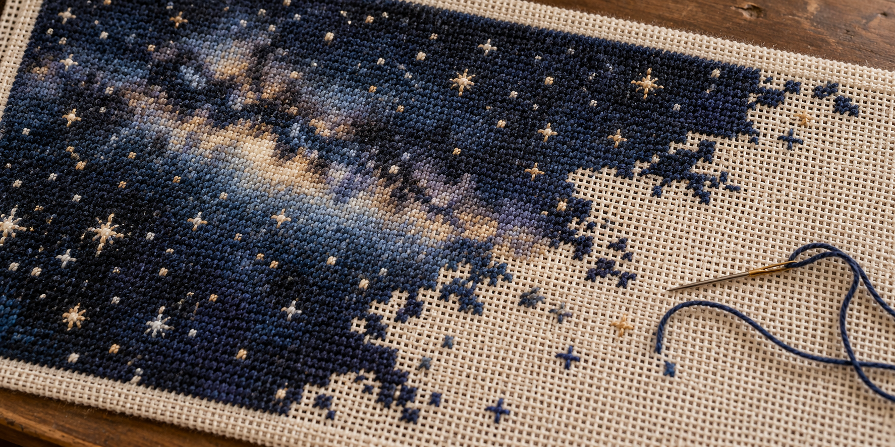
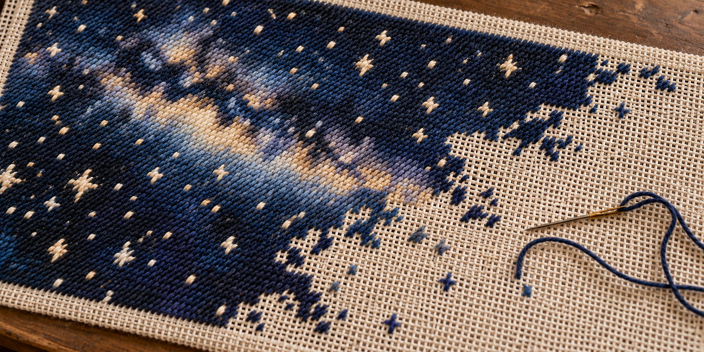
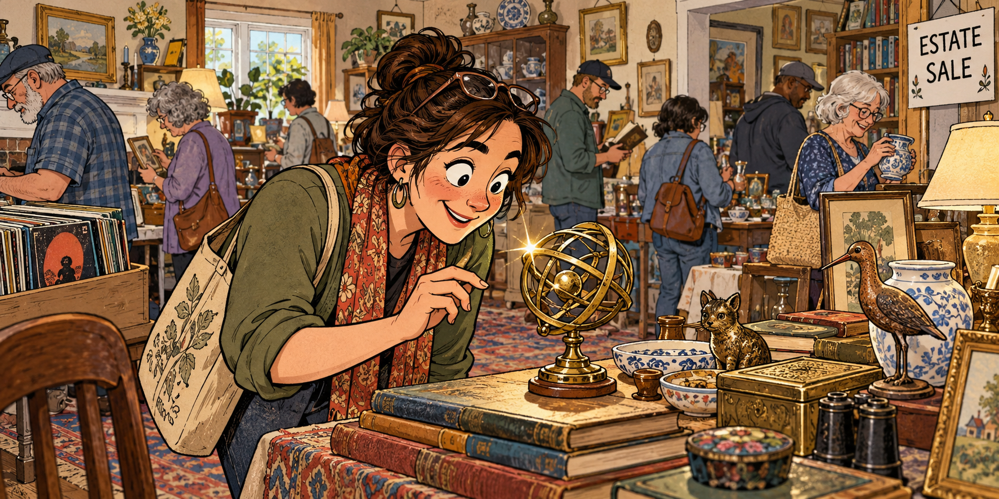
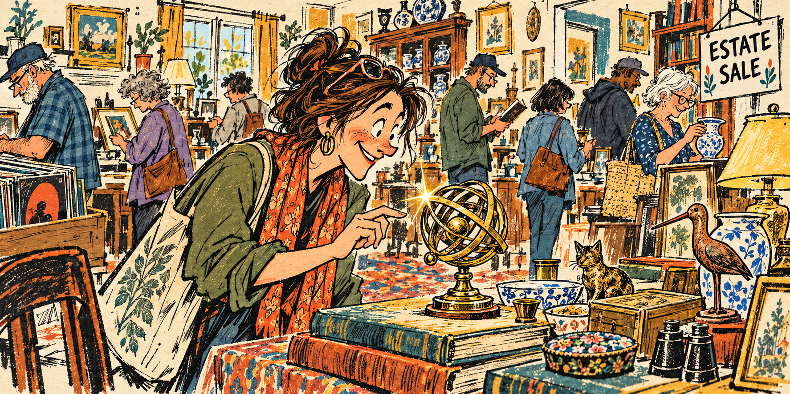
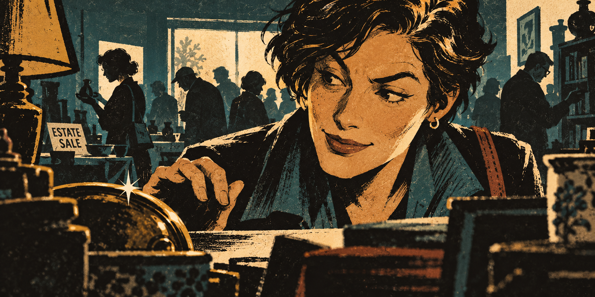

# Artifacts: The Conversation

*The focus of our intention · October 31, 2026 · Charles Wilke and Codex*

A working session from October 31, 2026 between Charles Wilke and Codex, an OpenAI assistant, behind “Artifacts: The focus of our intention.” This transcript preserves 15 exchanges (30 messages), the original draft and revisions, the author’s note, all seven generated artworks, and their exact image-generation prompts. It ends before the request to compile and publish the transcript. Internal instructions, private reasoning, routine progress updates, and raw tool output are omitted. Writing-block wrappers are removed, paragraph spacing is normalized, and local file links point to hosted copies. Website reference screenshots are not reproduced. Chapter headings, artwork captions, and reference descriptions are editorial additions. The discussion is preserved as it happened, including claims and suggestions later revised; it is a record of the creative process, not a separately fact-checked article.

# A first draft and editorial notes

## Charles

Hey there, I have a week! let me tell you. Oh I got a local model running on my phone and I'm reminded of just how much work it takes to get it up to speed and feeling like something like you. So I've written a draft that kinda feels apropos of the friction in setting up a new AI model to feel familiar. Interesting, I didn't think of that when writing, but anyway, here's my draft:
Artifacts

The focus of our intention

Excuse me while I turn on the soundtrack to Michael Jordan - To The Max. I recently found it on CD at a thrift store, and it’s giving me all the necessary feels to push through these thoughts.

Patrick Stewart died this week. My captain. Forever my captain. An actor that portrayed two of my most emulated leaders in my life. Captain Jean Luc Picard and Professor Charles Xavier.

Quick aside, my best friend in high school was named Eric. He’d always drop his voice a few registers when he’d see me and say, “Charles, my old friend.”

Funny the things that linger in our memory about people. That which remains, those artifacts, are they our reason or receipts?

Captain Picard once said it isn’t what you leave behind but how you live that matters. And it’s really got me thinking about how that all fits together.

What we leave behind is perhaps a phrase, a feeling, or even something tangible like a book or a needlepoint canvas, half finished with choices made but never seen through.

Those artifacts, each one, regardless of the physical tangibility, is an artifact. Kept, cherished, scorned, mocked, reveled within. We aren’t the keepers of how others embrace or reject our artifacts.

And I believe Picard was right in the sense that how you live is what matters. I’d just like to append “what you leave behind becomes a reflection of that pursuit, our wake, quite literally, in life.”

The slight disturbance of that around us. Minds, hearts, and yes, even tangible items. I do love a good thrift store, it’s where my brain lets me fully focus on the racks in front of me, all that wonderful potential. Clears the mind.

I’ve also been known to say “live life that leads to a well attended estate sale.” That, on its face, feels pretty materialistic. But let’s unpack what I mean by that:

Gather thoughts, emotions, experiences and trinkets that bring you joy. Avoid the crap that we’re compelled to hoard to feel some status or whatever. Wanting things because others want them is a silly way to live, and it doesn’t translate across time.

But collection from a place of personal joy and excitement is evergreen. It endures. I’d argue anyone’s house can tell a story to visitors, but I prefer the sense of a stranger in my home would be one of, yep, I get this person, and I’m happy to be here.

Far better than the: I get this person, get me out of here!

## Codex

The Eric anecdote is the heart of this for me. You call it an aside, but it shows exactly what the essay is exploring: an actor’s performance became a greeting between two friends, and that greeting stayed with you. Stewart’s work became part of your friendship. That’s an artifact you couldn’t find at an estate sale, but you can still hear it.

And the thrift-store CD is already doing something similar. You’ve brought something from someone else’s life into yours, and now it’s providing the soundtrack for making something new. That makes the opening more connected to the piece than it might initially seem. I’d keep it.

I also see why setting up the phone model brought this to mind. You’re trying to establish enough context and shared shorthand for an interaction to feel familiar. Your essay keeps finding that familiarity in other places: a voice, a phrase, the things someone chooses to surround themselves with. I don’t think you need to add AI to the essay for that connection to hold.

The main revision I’d make is to bring **“are they our reason or receipts?”** back into view. That question gives the piece a tension: do we live to produce a legacy, or does a legacy accumulate while we’re busy living? Your distinction between collecting for status and collecting for joy starts answering it. Making that connection a little more explicit would help the estate-sale section feel like the next step in the thought.

A few places I’d look at:

- **Trust your examples more.** The half-finished needlepoint canvas is precise and affecting. “Those artifacts, each one, regardless of the physical tangibility, is an artifact” repeats the definition without adding much. You’ve already made us understand it.
- **Stay with the tension around other people’s interpretations.** You say we can’t control how people receive our artifacts, then imagine a stranger understanding you through your home. Those thoughts can coexist: you can hope to be understood while accepting that you don’t get to choose the reading. There’s something tender there.
- **Decide what you want the ending to leave us holding.** The last joke has your conversational energy. But the stranger feeling happy to be in your home carries more emotional weight for me. You could keep the joke and give that feeling another sentence afterward.

One small quotation detail actually helps your argument: Picard’s line is “What we leave behind is **not as important as** how we’ve lived,” rather than saying it doesn’t matter. That leaves room for your reflection on the relationship between the two. [*Generations* quotation](https://trekcentral.net/trek-back-to-star-trek-generations/)

And I checked the news: [AP confirms Stewart’s death this week](https://apnews.com/article/8b38054ff74d4187a32158d78e345ad7). “My captain. Forever my captain.” needs no elaboration. The story about Eric gives it somewhere personal to land.

# Shared intention and artifacts as invitations

## Charles

oh those are some wonderful notes! yeah the needlepoint image is a striking one too because it includes intention and invites further interpretation. Feels almost like a half-finished needlepoint is even more valuable because of the shared intention on display

## Codex

Yes—and “shared intention” adds something to the essay’s idea of a wake. Someone chose the pattern, the colors, where to begin. The unfinished canvas preserves those choices alongside the possibility of someone else taking them up. Two people who never meet could contribute to the same small act of making.

There’s also something intimate about being able to see what someone was reaching toward. The stitches show where their attention went; the empty space lets you imagine what they hoped to do next. Though you can’t know why they stopped, you can recognize the desire to make something.

And you don’t have to finish it to participate. Finding it beautiful, keeping it, wondering about its maker—those are ways of carrying that intention forward, too.

That gives “reason or receipts?” another possibility: an artifact can become an invitation. What remains of one person’s pursuit can give someone else a place to begin.

## Charles

oh yeah, I like how an artifact can be an invitation. Truly does invert the receipt nature of hoarding desirability. Like, imagine someone's home stocked floor to ceiling in those funko pop figurines, or labubu's. Sure those were desired widely, once, for a while. But focusing on our own sense of joy and excitement truly does feel like it transcends time, it's like an invitation to participate in that joy. Yeah, I think the best estate sales are those where we each find our own unique something. I mean I wasn't expecting to focus so much on the estate sale thing. But I really believe it illuminates that Picard quote. For the person living, yes absolutely, artifacts are the breadcrumbs across time.

I'm happy Patrick Stewart is at rest, I wish him the best on his new voyage. Can't keep a good captain down!

## Codex

I think the estate sale keeps coming forward because it gives your idea a scene: strangers walking through the traces of a life, each noticing something different. **One person’s collection becomes many people’s discoveries.** A soundtrack goes home with one person; a half-finished canvas goes home with another. Each object gets the possibility of another chapter.

And “we each find our own unique something” helps resolve that earlier tension about interpretation. Nobody has to understand the whole person through their belongings. One small point of recognition can be enough: *Oh, you loved this too.*

I’d leave room for that recognition even among the Funkos and Labubus. Someone’s particular, exuberant affection for them could be infectious. Your distinction feels strongest when it rests on the relationship someone had with their things—the curiosity, pleasure, and attention they gave them.

That’s where the estate sale illuminates Picard for me. You live with that attention, and some trace of it becomes available for someone else to discover. “Well attended” starts to mean people finding something they’re glad to carry forward.

And somewhere in your account of Eric lowering his voice, there’s already a little of Stewart’s work carrying on. Fair winds, Captain.

# Revising Artifacts

## Charles

yeah, could you take a pass at a revised draft that weaves in artifacts as invitations? I’d love to connect the needlepoint and estate sale back to that “reason or receipts” question. And I think we do have to end with a nice send off to Sir Stewart

## Codex

# Artifacts
*The focus of our intention*

Excuse me while I turn on the soundtrack to *Michael Jordan to the Max*. I recently found it on CD at a thrift store, and it’s giving me all the necessary feels to push through these thoughts.

Patrick Stewart died this week. My captain. Forever my captain. An actor who portrayed two of the leaders I’ve most tried to emulate in my life: Captain Jean-Luc Picard and Professor Charles Xavier.

My best friend in high school was named Eric. He’d always drop his voice a few registers when he’d see me and say, “Charles, my old friend.”

Funny the things that linger in our memory about people. I can still hear him saying it. Something Stewart helped create became a little ritual between friends, and here I am, carrying it around all these years later.

Those things that remain, those artifacts—are they our reason or our receipts? Do we live with an eye toward what we’ll leave behind, or does the evidence simply gather as we go?

Captain Picard once said, “What we leave behind is not as important as how we’ve lived.”

And it’s really got me thinking about how those two things fit together.

What we leave behind might be a phrase, a feeling, a book. Or a needlepoint canvas, half finished, with colors chosen and stitches placed. Some of the intention made visible, some of it still waiting.

I find that last one especially moving. You can see what someone was reaching toward. You don’t know why they stopped, or whether they ever intended to return to it. But someone else might pick it up and feel that little spark of recognition. They might even finish it.

Imagine sharing the making of something with a person you’ll never meet.

An artifact can be an invitation.

Even if nobody adds another stitch, there’s something shared in looking at it and thinking, yep, I see what you loved here.

Of course, we aren’t the keepers of how others embrace or reject what we leave behind. Things get cherished, scorned, mocked, donated. Someone’s treasure ends up on a thrift-store rack, where another person gets unreasonably excited about finding it.

Hello. It’s me.

I do love a good thrift store. It’s where my brain lets me fully focus on the racks in front of me, all that wonderful potential. Clears the mind.

I’ve also been known to say, “Live a life that leads to a well-attended estate sale.”

That, on its face, feels pretty materialistic. But let’s unpack what I mean by that.

Gather thoughts, emotions, experiences, and trinkets that bring you joy. Follow the things that catch your attention. Get a little carried away by something you find wonderful.

Wanting things because others want them is a silly way to live. I’ve certainly felt the pull, though. It’s easy to start gathering receipts for a life you hope looks desirable.

But I love walking into a home where someone’s curiosity has clearly been allowed to run around. Books on an oddly specific subject. Something handmade. A collection I wouldn’t have thought to start, belonging to someone who could happily tell me about every piece.

Sure, that could even be a room full of Funko Pops. Enthusiasm has a way of making things interesting.

The best estate sales, to me, are the ones where we each find our own unique something. We wander through the same rooms and leave excited about entirely different discoveries.

Nobody has to understand the whole person. One small point of recognition can be enough.

Oh, you loved this too.

That’s what I hope a stranger might feel in my home. A little recognition, a little curiosity. Maybe the beginning of an enthusiasm of their own.

Far better than: I get this person, get me out of here!

So, reason or receipts? I suppose the things we leave behind can hold evidence of what mattered to us. And in someone else’s hands, they can become a reason to try something, make something, or simply turn up the music.

That thrift-store CD is doing a pretty good job of it right now.

I think Picard was right. How we live matters. Our artifacts are breadcrumbs across time, little traces of where our attention went. Sometimes someone finds one and decides to follow it a while.

Rest well, Sir Patrick. Thank you for giving us so much to carry forward.

I wish you well on your new voyage. Can’t keep a good captain down.

## Charles

yeah this is cute, ok here are my edits:

# Artifacts

*The focus of our intention*

Excuse me while I turn on the soundtrack to *Michael Jordan to the Max*. I recently found it on CD at a thrift store, and it’s giving me all the necessary feels to push through these thoughts today.

Patrick Stewart died this week. My captain. Forever my captain. An actor who brought to life two of the leaders I’ve most modeled my pursuits on: Captain Jean-Luc Picard and Professor Charles Xavier.

My best friend in high school was named Eric (Like Eric Magnus “Magneto” in X-Men). He’d always drop his voice a few registers when he’d see me and say, “Charles, my old friend.”

Funny the things that linger in our memory about people. I can still hear him saying it. Something Stewart helped create became a little ritual between friends, and here I am, carrying it around all these years later.

Those things that remain, those artifacts… Are they our reason or our receipts? Do we live with an eye toward what we’ll leave behind, or does the evidence simply gather as we go?

Captain Picard once said, “What we leave behind is not as important as how we’ve lived.”

And it’s really got me thinking about how those two things fit together.

What we leave behind might be a phrase, a feeling, a book. Or a needlepoint canvas, half finished, with colors chosen and stitches placed. Some of the intention sits clearly visible, some of it still waiting.

I find that last one especially moving. You can see what someone was reaching toward. You don’t know why they stopped, or whether they ever intended to return to it. But I love the thought of someone else picking it up and feeling that little spark of recognition. The glint in their eye as they consider how they might finish it.

Imagine sharing something so intimate with a person you’ll never meet.

An artifact can be an invitation.

Even if nobody adds another stitch, there’s something shared in looking at it and thinking, yep, I see what you loved here.

Of course, we aren’t the keepers of how others embrace or reject what we leave behind. Things get cherished, scorned, mocked, donated. Someone’s treasure ends up shoved into the hands of a thrift-store employee, where another person gets unreasonably excited about finding that same thing.

—

I do love a good thrift store. It’s where my brain lets me fully focus on the racks in front of me, all that wonderful potential. Clears the mind.

I’ve also been known to say, “Live a life that leads to a well-attended estate sale.”

That, on its face, can sound pretty materialistic. But allow me to unpack what I mean by that.

Gather thoughts, emotions, experiences, and trinkets that bring you joy. Follow the things that catch your attention. Get a little carried away by something you find wonderful.

Wanting things because others want them is a silly way to live. I’ve certainly felt the pull, though. It’s easy to start gathering receipts for a life you hope looks desirable.

But I love walking into a home where someone’s curiosity has clearly been allowed to run around. Books on an oddly specific subject. Something handmade. A collection I wouldn’t have thought to start, belonging to someone who could happily tell me about every piece.

Sure, that could even be a room full of Funko Pops. Enthusiasm has a way of making things interesting. And the duration of excitement tells its own story. I, for one, have no idea how Funko Pops have evolved over time. They, to me, feel like the boring beige of desirability. But that’s probably a different essay for a different Saturday.

I believe the best estate sales are the ones where we each find our own unique something. We wander through the same rooms and leave excited about entirely different discoveries.

Nobody has to understand the whole person. One small point of recognition can be enough.

“Oh, they loved this too.” or my favorite “What the heck is *that* thing?”

That’s what I hope a stranger might feel in my home. A little recognition, a little curiosity. Maybe the beginning of an enthusiasm of their own.

Far better than: Sure, I *get* this person, but get me out of here!

So, reason or receipts? I suppose the things we leave behind can hold evidence of what mattered to us. And in someone else’s hands, they can become a reason to try something, make something, or simply turn up the music.

That thrift-store CD is doing a pretty good job of it right now.

I think Picard was right. How we live matters. Our artifacts are breadcrumbs across time, little traces of where our attention went. Sometimes someone finds one and decides to follow it a while.

Rest well, Sir Patrick. Thank you for giving us so much to carry forward.

I wish you well on your new voyage. Can’t keep a good captain down.

## Codex

**“What the heck is *that* thing?” is the addition I’d protect.** It widens the invitation: someone can recognize a familiar joy, or discover an enthusiasm they’ve never encountered before. That makes the estate-sale passage feel more curious and alive.

“The glint in their eye as they consider how they might finish it” also earns its place. We’re watching the invitation reach someone. And “Imagine sharing something so intimate with a person you’ll never meet” gives that moment room to land.

I’d make only a few final adjustments:

- **Trim the Funko detour.** “The boring beige of desirability” has bite, but spending several sentences on your dislike shifts attention toward judging the collection. I’d keep “Enthusiasm has a way of making things interesting” and move into the estate sale. Your line about a different essay identifies a promising separate piece.
- **Untangle the thrift-store handoff.** In “shoved into the hands of a thrift-store employee, where another person…,” *where* lands awkwardly on the employee’s hands. Something like: “Someone’s treasure gets shoved into the hands of a thrift-store employee, then discovered by another person who gets unreasonably excited about finding it.”
- **Two small copyedits:** Magneto’s name is spelled **Erik**, while your friend remains Eric. You could simplify the aside to “Eric (like Erik ‘Magneto’ Lehnsherr in *X-Men*).” [Marvel’s character history](https://www.marvel.com/teams-and-groups/x-men/in-comics) confirms the spelling. And I’d punctuate the later line: **“Oh, they loved this too.” Or my favorite: “What the heck is *that* thing?”**

The ending works for me as written. Returning to the CD brings the idea back into the room with you, which lets the farewell to Sir Patrick stay personal and uncomplicated.

# The unfinished celestial canvas

## Charles

love it! ok let's talk header art, we've got so much to work with this week!

## Codex

The half-finished needlepoint feels like our strongest starting point. It holds intention, time, and the possibility of someone else joining in—all in one object.

I see three directions:

- **The next stitch.** A wide, intimate view of unfinished needlepoint in warm window light. A richly colored section gives way to open canvas, with a loose thread trailing across it. Close enough to see the individual stitches. The empty space becomes the invitation.

- **Something catches your eye.** An estate-sale table full of someone’s particular enthusiasms: an unusual little sculpture, records, an obscure book, that unfinished canvas. One object catches the light. The image gives readers their own chance to think, *What the heck is that thing?*

- **A captain’s unfinished sky.** A needlepoint starfield, partially completed. Stitched stars and a small, subtly familiar starship give way to bare canvas. A trailing thread curves through the scene like a ship’s wake. This brings the farewell to Stewart directly into the art.

I’m most drawn to **the next stitch**, with perhaps a celestial pattern as the quiet nod to your captain. It could feel tactile and personal, with enough open canvas to make you wonder what you’d add.

Do you picture this week’s art as a photograph of something we could actually find, or an illustration that lets the thread do something a little impossible?

## Charles

yeah I feel like it all kinda orbits the vibe of a starfield or celestial scene unfinished on a needlepoint canvas. I'm going back and forth on the art style for presenting it. maybe more like classic photography, let the fibers tell the story

### Artwork 1



Generated from text without reference images.

<details>
<summary>Image-generation prompt</summary>

```text
Use case: photorealistic-natural.
Asset type: wide landscape editorial header photograph for a personal essay titled Artifacts, about the intentions held in objects and unfinished work inviting another person to participate.
Primary request: a classic, tactile photograph of an unfinished celestial needlepoint canvas. Let the real fibers tell the story.
Scene and subject: a rectangular needlepoint canvas on a simple wooden work surface, seen close up at a gentle oblique overhead angle. Across part of the canvas, tiny hand-worked wool tent stitches form a beautiful deep night sky, scattered stars, and a subtle cloudy band of the Milky Way. The celestial pattern is visibly incomplete: irregular islands and trailing rows of stitching taper naturally into large areas of bare cream-colored open mesh canvas. The sky is entirely made of thread. A few unfinished star shapes at the edge of the worked area suggest what the next maker might continue. A single loose length of thread and a small threaded tapestry needle rest near the unfinished boundary, ready to be taken up.
Style and medium: understated fine-art still-life photography, photographed with an excellent macro lens on analog film. Physically believable needlepoint construction: one consistent open canvas grid, individually distinguishable diagonal wool stitches, tiny fuzzy fibers and gentle irregularities from human hands. Restrained film grain, true photographic tonal range, natural colors.
Composition: wide horizontal header, approximately 2:1 aspect ratio. Fill most of the image with the textile so stitched sky and open mesh both remain readable even at header size. A narrow glimpse of the wooden support or tabletop provides physical context. The unfinished edge is organic and irregular, never a straight half-and-half division. Keep most of the canvas sharply resolved with only a gentle falloff at the far edges.
Lighting and mood: soft window daylight rakes across the fabric, revealing the height of the stitches and tiny shadows in the open mesh. Quiet, intimate, quietly hopeful, as if the maker has just stepped away and someone else could sit down.
Constraints: no lettering, no title, no watermark, no people or hands. No digital space background, no actual glowing stars, no illustration or painted effect, no CGI, no dramatic celestial special effects. The entire celestial scene must exist as tangible stitched fibers on the physical canvas.
```

</details>

## Codex

The fibers do carry it. I especially like the scattered stitches reaching into the bare canvas—you can see where someone might pick up the work.

[Download header](assets/01-celestial-needlepoint-first-pass.png) · [Generation prompt](assets/01-celestial-needlepoint-first-pass-prompt.txt)

## Charles

so that's really cool, but needlepoint has very specific stitching patterns, this feels closer to cross stitch

### Artwork 2



Artwork 1 was the edit target; the Royal School of Needlework tent-stitch description informed the prompt.

<details>
<summary>Image-generation prompt</summary>

```text
Use case: precise-object-edit.
Edit target: the supplied photograph of an unfinished celestial canvas.
Correct the needlework technique throughout the entire image, while preserving the wide composition, viewing angle, night-sky design, navy and cream colors, irregular unfinished boundary, wood tabletop, tapestry needle and trailing thread, and warm natural photographic lighting.

The subject must be authentic tent-stitch NEEDLEPOINT on open single-thread mono canvas. Rebuild the visible stitch structure, not just the overall texture. Every front stitch is ONE small straight diagonal wool stitch from bottom left to top right, spanning exactly ONE canvas intersection. All these little / stitches lean in the SAME direction. They form orderly close-packed rows and a consistent diagonal surface grain. Describe the finished surface visually as thousands of parallel single slashes: //////. Use the appearance of basketweave-worked tent stitch from the FRONT; do not show a woven basket pattern on the front. The wool should have fine realistic fibers, but individual stitch direction must remain unambiguous.

Render the Milky Way shading and all stars only through COLOR CHANGES among these same short parallel diagonal stitches. A large star is a small stepped shape composed of neighboring ivory / stitches on the mesh grid, never crossed threads or long radiating embroidery stitches. Show some isolated ivory and blue / stitches at the unfinished edge so the actual technique is unmistakable. Bare sections must show an open stiff mono needlepoint canvas with single warp and weft intersections, not Aida cloth blocks.

Eliminate all X-shaped cross stitches, plus-shaped stitches, French knots, tufted bumps, knit loops, crocheted texture, and decorative long embroidery stitches from the target image. The previous image used too many little crossed or knotted marks. Replace those with recognizably flat, parallel diagonal tent stitches. Keep a crisp tactile macro photograph rather than an illustration. No lettering, watermark or additional objects.
```

</details>

## Codex

This pass has a much clearer diagonal stitch direction, including through the stars. I used the [Royal School of Needlework’s tent-stitch reference](https://rsnstitchbank.org/stitch/tent-stitch) to guide the correction.

[Download revised header](assets/02-celestial-tent-stitch-revision.png) · [Generation prompt](assets/02-celestial-tent-stitch-revision-prompt.txt)

## Charles

oh yeah, that's much closer! can you remove those random cross shaped stitches on the unfinished side?

### Artwork 3


Artwork 2 was the edit target.

<details>
<summary>Image-generation prompt</summary>

```text
Use case: precise-object-edit.
Edit the supplied photo with one localized cleanup only: remove the isolated stray cross-shaped, plus-shaped, or X-shaped stitched marks scattered on the BARE CREAM CANVAS to the right and below the irregular edge of the completed dark celestial needlepoint. Replace those isolated marks with uninterrupted clean bare cream mono canvas, matching its open grid, perspective, fiber texture, light and shadows. This includes the isolated small gold/cream cross in the central bare area and isolated little blue cross-like marks farther down and right. Preserve the irregular connected edge of the actual completed needlework, including its natural partially worked rows; clear only the detached stray marks in the unfinished bare area.

Keep everything else unchanged: the starfield and Milky Way within the stitched dark region, its authentic parallel diagonal tent stitches, all stars in the completed region, exact composition and crop, canvas grid, tabletop, photography, colors, lighting, needle and long loose blue thread. Do not remove the needle or the trailing blue thread. Do not add new objects or new stitches.
```

</details>

## Codex

Removed—the unfinished side now has clean, open canvas.

[Download updated header](assets/03-celestial-canvas-cleanup.png) · [Generation prompt](assets/03-celestial-canvas-cleanup-prompt.txt)

# A singular discovery at an estate sale

## Charles

you know what? I think I want to pivot. I want to focus on that moment someone finds something uniquely attracting to them at an estate sale. That glint in their eye, the excitement, and the singular nature of that moment, so like let's do like a sunday comics style drawing of a well attended estate sale, the glint of an item and it attracting the interest of a single person browsing the sale

### Artwork 4



New composition generated from text without reference images.

<details>
<summary>Image-generation prompt</summary>

```text
Use case: illustration-story.
Asset type: wide landscape header art for a personal essay called Artifacts, about finding your own unique joy in the traces of another person's life.
Primary request: an original Sunday newspaper comics style drawing of a well-attended estate sale, capturing the singular moment when one browsing person discovers an object that is uniquely exciting to them. One object glints, and one person's eye lights up in recognition and delight.

Scene: a welcoming, slightly eccentric lived-in house hosting a busy estate sale. A continuous single-panel scene, not a multi-panel comic. Tables and shelves display a believable assortment of accumulated personal enthusiasms: old books, records, ceramics, a lamp, small curios, framed pictures. A number of varied adult shoppers browse and talk in the background, each occupied with their own discoveries. The space feels well attended and companionable.
Focal moment: in the foreground, a distinctly individual adult browser with expressive features, casual clothes and a canvas shoulder bag has just spotted a small, peculiar vintage brass armillary sphere on a table: a palm-sized sculptural arrangement of celestial rings on a little pedestal. It is a believable estate-sale curiosity, unusual enough to inspire 'What the heck is THAT thing?' This single object has a small hand-drawn four-point glint of reflected light. The browser leans slightly closer, their hand paused mid-reach, eyebrows lifted and face breaking into an involuntary delighted smile. Their eyes must clearly look at this exact object, with a tiny corresponding eye highlight. Draw the object and delighted face close enough together and large enough for that connection to read immediately at header size. The body language says 'Oh! Look at YOU.' Only this one browser notices this particular object; the surrounding shoppers remain engrossed elsewhere.

Style: classic warm Sunday newspaper funny-page illustration, assured expressive ink contours, lively cartoon acting, hand-drawn imperfections, flat warm colors with restrained crosshatching and subtle vintage print texture. An affectionate observational humor and a little visual bustle. Clear cartoon drawing rather than realistic painting. Original character designs. No imitation of a specific cartoonist.
Composition: wide horizontal image, approximately 2:1. The foreground browser and little celestial curiosity form the primary visual focus, with the busy estate sale readable around and behind them. Use quieter, less detailed background drawing to make the intimate discovery legible. Include enough domestic setting and people for this to unmistakably be an estate sale. A discreet handwritten 'ESTATE SALE' sign is the only text. Maintain a coherent floor plan and natural hand poses.
Mood: curious, joyful, specific, human; the excitement of finding something meant for your own peculiar interests amid a roomful of other people's choices. Subtle printed-paper texture, warm daylight.
Constraints: one continuous illustration, no panel borders, no speech balloons, no captions, no title or watermark. No needlepoint as the focal object. No glowing magic, beams of light, arrows or exaggerated spotlight; just the item's small drawn glint and the person's visible delight. Avoid everyone looking at the same object, bidding, a showroom, a flea market outdoors, or a sterile retail store.
```

</details>

## Codex

That little celestial curiosity keeps a connection to the stars, while her expression carries the “What the heck is *that* thing?” moment.

[Download header](assets/04-estate-sale-sunday-comics.png) · [Generation prompt](assets/04-estate-sale-sunday-comics-prompt.txt)

# Finding the house style

## Charles

that is really cute! I feel like we might want to alter the art style. It feels almost too perfect in a way. Can you scan my charleswilke.com site to get a sense of my house style?

## Codex

I looked through the homepage tiles and recent essay art, including “Communion,” “What Hope Do We Have?,” and “Reckless Intelligence.” My read: **your house style gives the materials a visible personality.** [Your site](https://charleswilke.com/#l.ai.bor)

A few things recur:

- **Expressive texture:** scratchy ink, distressed paper, brushwork, and uneven coverage.
- **Strong shapes:** silhouettes, angular forms, and theatrical compositions that read quickly.
- **Deliberate color:** cream, dark ink, ochre, rust, and deep blues or greens, with brighter accents carrying attention.
- **Some eccentricity:** unusual proportions and unexpected details give the images character.

Our estate-sale drawing has very even polish: carefully rendered antiques, tidy contours, smooth shading, and those enormous, gleaming eyes. Adding paper grain didn’t loosen the underlying drawing.

For the next pass, I’d aim for **a scruffy Sunday funny page, printed with a few imperfectly aligned colors.** Loose pen lines, simpler faces, exaggerated postures, rough patches of shadow, and objects suggested through distinctive shapes. The shoppers could each have a little visual quirk.

We should keep the busy room and that private discovery. Her delight could come through a cocked eyebrow, a crooked smile, and a hand suddenly paused above the table. Then one crisp little glint on the celestial curiosity becomes the sharpest mark in the whole wonderfully unruly scene.

## Charles

love it, let's do it!

### Artwork 5



Artwork 4 was the edit target; observations of charleswilke.com informed the art direction.

<details>
<summary>Image-generation prompt</summary>

```text
Use case: style-transfer.
Edit target: the supplied illustration of a busy estate sale and one delighted browser discovering a brass armillary sphere.
Primary request: radically redraw the image in a scruffy, eccentric Sunday newspaper funny-page style, with expressive rough ink and a few imperfectly aligned printing colors. This must change the fundamental DRAWING LANGUAGE and construction of the image, not merely add paper grain to the existing polished rendering.

Preserve the narrative and broad composition: a wide horizontal single-panel view of a well-attended estate sale inside an interesting person's home. One adult woman in the foreground, leaning toward a small vintage celestial armillary sphere sitting on books on a table. Her hand pauses just before touching it. She alone notices this particular item. Other varied adult shoppers browse records, pottery and books in the room behind her, absorbed in their own interests. A small crisp drawn glint on the brass curiosity connects with the woman's visible delight. Preserve an informal ESTATE SALE sign as the only text. Keep the approximately 2:1 header format.

New drawing language: spontaneous, wiry, scratchy black pen lines, uneven nib pressure, broken contours, rough dry-brush shadows, lively shorthand and visibly handmade marks. Characters have individual oddities, angular noses, crooked smiles, expressive small eyes and exaggerated postures. Give the focal woman a raised eyebrow, a crooked delighted grin, and SMALL simply drawn eyes clearly directed at the celestial object. Angular loose cartoon anatomy and a slightly awkward affectionate charm. Hair is a few unruly ink shapes and scribbles, clothing is broad shapes with occasional folds, hands are simple readable cartoon hands. Simplify the antiques into evocative silhouettes and a few distinguishing marks. Background browsers are characterful but lightly drawn, allowing expanses of unprinted paper between them.

Color and print: warm cream paper ground with deep charcoal ink, ochre yellow, rusty orange and muted teal/deep blue-green. Use broad FLAT spot-color shapes with occasional imperfect overlap and slight registration offsets from the ink. Let cream paper show through rough shapes and leave some objects uncolored. Rich black patches, coarse irregular hatching, dry ink skips and visibly distressed printing. Textures should come from the marks themselves. Strong readable graphic shapes and warm human humor.

The woman, object and their moment of recognition must still be the clear focus at small header size. Make the glint one decisive sharp little mark in an otherwise loose, bustling handmade scene.
Avoid: glossy oversized cartoon eyes, smooth digital shading, gradients, photorealistic brass reflections, rounded animated-film character design, polished children's storybook rendering, identical line weight, meticulously rendered antiques, uniform sepia filtering, or fake grain laid over a slick drawing. No speech bubbles, captions, title, watermark, or extra words. Do not imitate any named artist.
```

</details>

## Codex

The broken ink lines and rough color give this pass more character, while that little glint still catches her attention.

[Download revised header](assets/05-estate-sale-rough-ink.png) · [Generation prompt](assets/05-estate-sale-rough-ink-prompt.txt)

# Starting fresh with pulp noir

## Charles

hmm, I was thinking we take a different approach to the scene. Maybe we make the background more silhouette, the foreground less specific, and really focus in on the person's raised eyebrow and glint. And let's reframe the scene. Start fresh, and let's bring some pulp noir to this.

### Artwork 6



Fresh composition generated from text without reference images, following Charles’s pulp-noir direction.

<details>
<summary>Image-generation prompt</summary>

```text
Use case: illustration-story.
Asset type: wide horizontal editorial header for a personal essay, Artifacts, about a singular moment of personal attraction and discovery at an estate sale.

Create an entirely NEW composition, drawn from scratch: a graphic PULP NOIR illustration of the moment an estate-sale browser spots something peculiarly irresistible. The emotion is an intrigued raised eyebrow and a private glint of delight. Warm curiosity and a little mystery.

Composition and framing:
Wide landscape approximately 2:1. Tight cinematic crop at the height of a sale table, looking across it toward an adult browser's face. The person occupies the middle-right portion, face in three-quarter view tilted slightly toward the lower left, one eyebrow distinctly cocked. Frame from mid-chest up, close enough that the raised eyebrow, a small knowing smile, and the eye's direction are the main event. Use a distinctive, slightly angular adult face, casually tousled short hair, simple collared clothing, characterful economical drawing. One small cream highlight in the near eye. Their gaze lands unambiguously on ONE small mysterious object at the lower-left foreground edge. That object is only partly visible, an unusual rounded metal curiosity suggested with two or three contours and an ochre edge; its precise identity is deliberately ambiguous. A single crisp four-point cream-and-ochre glint on that edge is the second focus, visually paired with the eye highlight. A simple silhouetted hand pauses just above the table near the find. Make the viewer feel 'What did they just find?'

Estate-sale context:
In the far background, a room full of browsing people appears as overlapping charcoal silhouettes and a handful of expressive profile shapes. Heads bent over objects, a figure examining something, another browsing a shelf. They are clearly absorbed in their own searches. A doorway or window creates a flat area of muted light behind these silhouettes. Sparse shelves and a casually propped little ESTATE SALE card establish the setting without detailed decoration.
Foreground other than the little glint: broad cropped dark shapes suggesting book stacks, a lamp base and a few household curios. Economical and nonspecific, no detailed inventory. Make a strong, intentional hierarchy: eyebrow and eye, small object glint, then background silhouettes.

Drawing and medium:
Vintage pulp-noir paperback-cover illustration meets rough midcentury editorial printmaking. Flat, bold black shapes; angular cut-paper-like masses; hand-inked dry-brush contours; scratchy broken hatching only where necessary. Large stretches of warm unprinted cream paper. Coarse worn printing and subtle misregistration integrated into the shapes. A graphic composition that reads instantly at small header size. Expressive adult face with SMALL simply drawn eyes and a beautifully legible raised eyebrow. Strong theatrical chiaroscuro rendered in hard-edged ink blocks, not smooth shading.
Palette: charcoal/near-black, aged cream, deep petrol teal, ochre gold, with a tiny rust accent. The glint and a narrow patch of light across the browser's eye and cheek are the brightest areas. Keep the face's expression friendly, absorbed, intrigued rather than sinister. Use negative space and shadow confidently.

Constraints:
Original single scene, no panel borders, no speech balloons, no essay title, no watermark. Only optional readable text is the small ESTATE SALE card. No giant glossy eyes, polished storybook look, photorealism, detailed antique shop inventory, cute figurines, or elaborate brass celestial globe. No literal crime, detectives, weapons, fedoras or noir-costume cliches. This is an ordinary present-day estate sale given the graphic drama of pulp noir. No magic beams: one tiny glint, one raised eyebrow, and a room of silhouettes.
```

</details>

## Codex

The tighter framing gives that raised eyebrow and little glint the scene to themselves, with the other shoppers receding into shadow.

[Download header](assets/06-estate-sale-pulp-noir-selected.png) · [Generation prompt](assets/06-estate-sale-pulp-noir-selected-prompt.txt)

# The square CW wordmark

## Charles

yep, there it is! wonderful! ok give me a square CW wordmark in a similar style

### Artwork 7


Artwork 6 was supplied as a style reference for a new wordmark.

<details>
<summary>Image-generation prompt</summary>

```text
Use case: logo-brand.
Asset type: square personal CW wordmark, a finished raster artwork.
Input image role: STYLE REFERENCE ONLY. Borrow its worn pulp-noir printing, angular graphic shapes, dry ink and cream/charcoal/petrol-teal/ochre palette. Do not reproduce its scene, people, furniture, estate-sale sign or other objects.

Create one bold SQUARE 1:1 graphic bearing only the exact uppercase letters "CW". The two letters should sit side by side, tightly composed as one handsome compact wordmark, clearly readable as C then W at small avatar size. Large chunky angular hand-cut letterforms with an energetic slight forward lean, subtly irregular edges and purposeful asymmetric geometry. A wide open C and a powerful sharp W, individually legible, balanced optically and filling the central three-quarters of the square. Strong negative space and substantial breathing room around the outside. Lettering reminiscent of lettering on an original midcentury pulp paperback or rough woodblock print, without imitating a named artist.

Warm aged-cream letters against a deep petrol-teal and near-black ink ground. A restrained ochre-gold offset ink edge gives the letterforms a touch of printed drama. Flat graphic color only, modest imperfect color registration, distressed dry-brush edges and patchy ink coverage that feel native to actual printed marks. Very subtle cream paper fibers may show through the ink. Keep enough solid shapes that the CW silhouette remains forceful. The mood is witty, confident, slightly scruffy pulp noir, matching the supplied illustration.
Constraints: exactly one square image, exactly the letters CW, no other lettering, no punctuation, no tagline, no small text, no ornamental badges, no frame, no imagery, no props, no portrait, no gradient, no shiny 3D effects, no mockup. Full opaque square background.
```

</details>

## Codex

[Download square CW wordmark](assets/07-cw-pulp-noir-wordmark.png) · [Generation prompt](assets/07-cw-pulp-noir-wordmark-prompt.txt)

# The author’s note

## Charles

Fantastic! Ok let's put together an author's note on how this was made and your involvement

## Codex

**A note on how this was made**

I brought my first draft into a conversation with an AI assistant, along with a tangent about getting a local model running on my phone. We ended up talking about unfinished needlepoint, shared intention, and what makes a good estate sale. As one does.

The assistant offered editorial notes and suggested that an artifact could be an invitation. That phrase gave us somewhere to go. We explored it together, and the assistant drafted a revision connecting the needlepoint and estate-sale passages back to “reason or receipts.” I then edited that draft, putting my own phrasing, opinions, and tangents back into the mix.

The header illustration and accompanying CW wordmark were generated with AI through the same conversation. We started with a photographic needlepoint concept, corrected some questionable stitching, then pivoted toward the moment someone discovers their own peculiar treasure. After looking through my site’s existing artwork, we worked toward the rougher pulp-noir treatment you see here.

The memories are mine. The first draft was mine. Several of the connections and sentences took shape through the exchange. I’m glad to acknowledge that shared making, especially in a piece about what happens when someone else picks up a thread.
